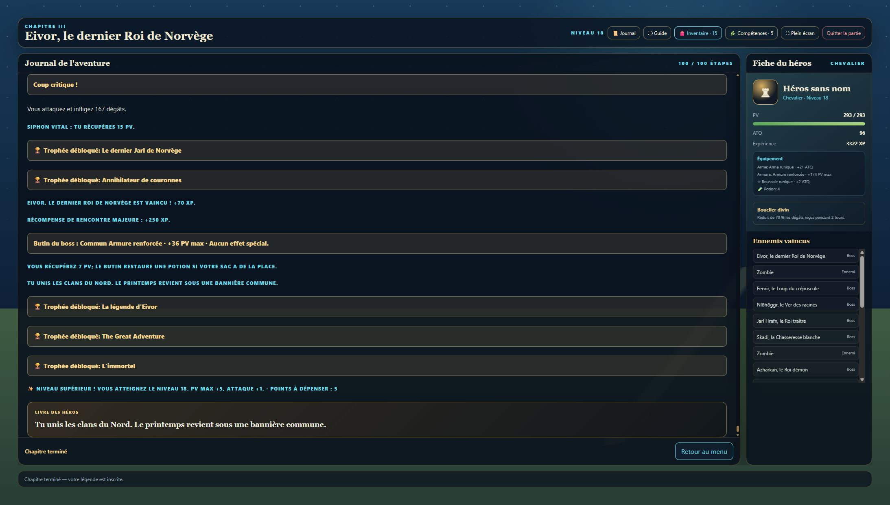

# Parcours réel de la campagne — Version 2.3

Parcours commencé le 7 novembre et terminé le 11 novembre 2026, dans le navigateur sur `http://127.0.0.1:8124/index.html`. Actions effectuées par les boutons du jeu, sans modifier l'état de la partie dans la console. Copie locale uniquement.

## Résultat observé

Les 225 étapes et les 15 boss ont été terminés en une campagne avec le même Chevalier. Le niveau, l'équipement, les compétences et les potions sont conservés entre chapitres. Des tentatives préalables ont échoué pendant les réglages du chapitre I; la campagne finalement terminée n'a pas connu de mort. Le profil possédait déjà certaines maîtrises de classe issues de ces essais : ce parcours n'est donc pas un test avec un profil entièrement vierge.

| Chapitre | Étapes | Boss vaincus | Niveau final | Fin choisie |
| --- | ---: | --- | ---: | --- |
| I | 50/50 | Jack Chistophe, Yhorm, Lothric/Lorian, Ilyan, Roi sans Nom | 10 | Refus du pacte de la relique |
| II | 75/75 | Gardien des Cendres, Reine des Mirages, Forgeron infernal, Prince des Abysses, Azharkan | 14 | Trésor partagé avec les royaumes |
| III | 100/100 | Skadi, Jarl Hrafn, Níðhöggr, Fenrir, Eivor | 18 | Union des clans du Nord |

État final : 293/293 PV, 96 ATQ, 3 322 EXP, 15 objets, 4 potions. Le profil affiche **18/42 trophées**, dont les trois fins, les quinze boss, « The Great Adventure » et « L'immortel ». Le niveau 20 et les trophées des autres classes n'ont pas été obtenus dans ce parcours.



## Fonctionnalités effectivement essayées

- Sauvegarde/reprise en cours de combat, y compris après rechargement au boss final; transitions de campagne I → II → III.
- Inventaire : équiper/déséquiper et constater la modification des statistiques; accumulation des butins de boss.
- Trois quêtes secondaires achevées : passage secret du chapitre I, cinq routes au chapitre II, runes/valkyries/tempête au chapitre III (terminée à l'étape 66).
- Arbres : rang II des trois voies au chapitre II; rang III, spécialisation puis ultime au chapitre III. Spécialisations choisies : Fauche-vie, Gardien vengeur, Alchimiste de guerre.
- Effets observés : renvoi de dégâts en défendant, soin de Posture réparatrice, vol de vie, attaque renforcée après potion (68 → 119 hors critique), phases II et attaques perforantes. Dernier rempart a été acheté, mais sa survie à 1 PV n'a pas été déclenchée.
- Journal de quêtes, décisions et bestiaire; portraits des boss rendus; aucun avertissement ni erreur JavaScript relevé dans la session finale.

## Corrections issues des essais

1. Un seul gestionnaire par bouton : fin des doubles actions et des étapes sautées.
2. Suppression d'une ancienne injection narrative qui répétait un pacte dans des scènes sans rapport.
3. Correction de la recherche du portrait par expression régulière (`entry.test.test(...)`). L'erreur bloquait le rendu au premier boss du chapitre II et faisait passer une sauvegarde valide pour illisible lors de sa reprise.
4. Réglage provisoire des boss : PV de base conservés; ATQ de base inchangée jusqu'à 7, puis coefficient 0,7 arrondi au supérieur. Les augmentations de phase II restent actives.
5. Cadrage sur le bloc ennemi pendant un combat : son portrait et son intention ne sont plus cachés sous la scène courante.
6. Le nom saisi reste présent après un changement de classe, vérifié avec deux sélections successives.
7. La boussole du cartographe est attribuée même si le joueur possède déjà une autre relique. Son identifiant propre empêche les doublons. Test de régression exécuté; la quête du parcours avait déjà été terminée avant ce correctif, sans attribution rétroactive.
8. Renouvellement du cache PWA : installation avec `cache: "reload"` pour éviter de recopier d'anciens scripts du cache HTTP. Vérifié par rechargement puis reprise du duel d'Eivor avec les nouveaux correctifs actifs.

## Avis après jeu et points restant à améliorer

La campagne est terminable avec ce héros, mais l'équilibrage reste inégal. Le chapitre I demande de gérer ses soins; le cumul d'équipement rend les chapitres II et III bien plus faciles. Níðhöggr est tombé en un seul critique; Eivor en deux attaques et une défense de test. Une future passe devra distinguer la campagne avec héros conservé d'un chapitre lancé avec un nouveau héros, sans supprimer le cumul des bonus demandé pour le jeu.

Les longues séquences Oui/Non restent répétitives. Beaucoup de choix modifient le texte ou la route sans changer le défi mécanique; dire Non permet d'éviter la majorité des rencontres ordinaires. Les conséquences annoncées dans le récit (soin, arme trouvée, allié) ne représentent pas toutes une récompense effective. Il faudrait sélectionner quelques décisions marquantes par chapitre et leur donner des effets durables.

Les trois arbres peuvent être maximisés dès l'entrée du chapitre III avec les points accumulés. Les spécialisations fonctionnent, mais cette abondance limite l'intérêt de construire un héros spécialisé. Le budget de points et l'accès progressif aux ultimes méritent une nouvelle passe.

L'intention ennemie donne les dégâts de l'état actuel : une transition en phase II provoquée par le joueur peut augmenter l'attaque avant la riposte. Ce changement n'est pas encore prévisualisé. Les portraits sont visibles, mais plusieurs boss partagent une illustration; les quinze boss n'ont pas quinze portraits uniques.

## Vérifications techniques

Commandes exécutées avec succès :

```powershell
node --check app.js
node --check service-worker.js
node tools/qa/check-progression-rules.mjs
node tools/qa/check-route-reward.mjs
node tools/qa/validate-assets.mjs
```

L'audit des assets trouve dix références de portraits, aucun fichier manquant et aucun SVG sans racine/viewBox valide. Le test de récompense couvre une relique déjà équipée, une boussole déjà présente, le cumul des statistiques et la non-répétition de la récompense.

Limites : une seule classe et un ensemble de choix joués jusqu'au bout; tous les trophées, toutes les langues, chaque spécialisation, un profil vierge, les chapitres lancés séparément, le hors-ligne et les appareils physiques iPhone/Android ne sont pas validés par ce parcours. Les scripts QA historiques qui pilotent un navigateur n'ont pas été lancés; le contrôle navigateur a été réalisé par l'interface.

## Pour reprendre

Le navigateur est laissé à l'écran-titre. « Jouer → Continuer » retrouve la campagne terminée. Choisir un chapitre puis lancer un héros commence une nouvelle partie. Les données sont propres à l'adresse utilisée : changer de port ou passer de `127.0.0.1` à `localhost` ouvre un autre stockage local.

Pour rouvrir exactement la même adresse depuis ce dossier si le serveur est arrêté :

```powershell
python -m http.server 8124 --bind 127.0.0.1
```

Puis ouvrir `http://127.0.0.1:8124/index.html`.
